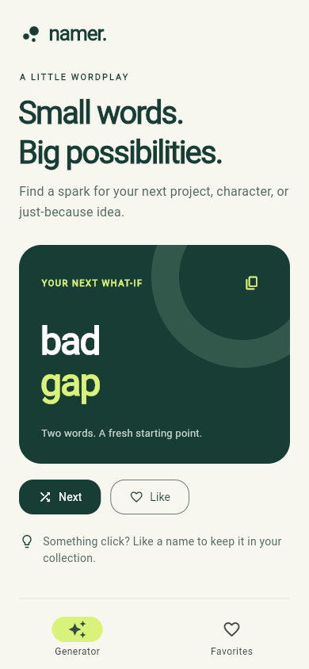
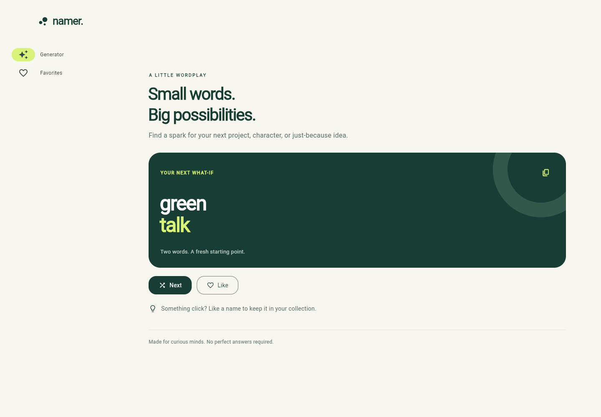

# Flutter Namer App — WeThinkCode_ Mobile Development Elective

**Repository verification code:** `WTC-3SJ3Z8M7`

This repository follows the [Flutter first app codelab](https://codelabs.developers.google.com/codelabs/flutter-codelab-first#0), building a responsive random word-pair generator with Material 3, Provider and ChangeNotifier.

## Features
- Generate random English word pairs with **Next**
- Copy a name to the clipboard with confirmation
- Like/unlike the current suggestion
- Browse saved favorites, remove them, and undo a removal
- Adaptive navigation: bottom bar on narrow screens, navigation rail on wider screens
- Widget tests for generation, favorite management, and the Like/Unlike flow
- Unit tests for state changes and ChangeNotifier listener notifications

## Design refresh — November 2026

A warm naming studio built with Flutter's Material 3 widgets: cream surfaces,
deep green name cards, lime accents, and a clearer visual hierarchy. The generator
has an animated two-line word reveal, a labeled copy control, and visible saved
feedback. Favorites include a guided empty state and an Undo action after removal.
Navigation adapts from a bottom bar to a rail. Content scrolls, actions wrap, and
text follows the system text size; name animations respect reduced-motion settings.

No new runtime packages, remote fonts, accounts, or network calls were added.
Copying writes only the selected name to the clipboard, on request. Favorites
remain in memory and reset when the app restarts.

The refresh was implemented with AI assistance and remains a learning project.
`MyAppState` still owns the data; widgets observe it through Provider. Undo restores
a removed name at its original position without creating duplicates.

## Learning concepts
- Stateless and stateful widgets; widget composition
- `ChangeNotifier`, `ChangeNotifierProvider`, `context.watch` and `notifyListeners`
- Declarative UI updates and Material 3
- Responsive layouts with `LayoutBuilder`
- Widget tests with `flutter_test`

## Run and verify
```bash
flutter pub get
flutter analyze
flutter test
flutter run -d chrome
```

## Architecture
`main()` → `MyApp` → `ChangeNotifierProvider<MyAppState>` → `MyHomePage` → `GeneratorPage` / `FavoritesPage`.

`MyAppState` owns the current `WordPair` and the in-memory favorites list. Favorites are not persisted between restarts.

## Evidence status — 6 November 2026

GitHub Actions has passed `flutter analyze`, all 12 state/widget tests, and the
release web build for the design refresh. The tests include copy feedback,
favorite removal with Undo, and phone/desktop navigation at double text size.
The preview workflow captures the actual Flutter web build. Generator previews
have been inspected at phone and desktop sizes; favorites are covered by interaction tests.
Android/iOS device testing remains separate from this web and widget validation.

### Code snapshot
- `lib/main.dart` — Material 3 app, Provider state, generator and favorites pages
- `test/widget_test.dart` — generator, save/remove, and Like/Unlike user journeys
- `test/app_state_test.dart` — state transitions and listener notifications
- `.github/workflows/flutter.yml` — automated static analysis and widget tests

### Evidence to capture
1. Generator screen showing a word pair and Like/Next controls.
2. Favorites screen showing a saved word pair and its remove button.
3. GitHub Actions green check for both static analysis and widget tests.
4. A narrated 5–10 minute demonstration explaining the code and interactions.

The application follows the Flutter codelab; the visual design, tests, and documentation are subsequent improvements. Firebase Authentication is a separate elective deliverable and is **not implemented in this repository**.

### Proof checklist
- [x] Word-pair generator and favorites implementation
- [x] Responsive navigation
- [x] Widget and state unit tests written
- [x] Static analysis and tests executed successfully
- [x] Generator screenshots at phone and desktop sizes
- [ ] Favorites screenshot
- [ ] 5–10 minute narrated demonstration recorded
- [ ] Final elective evidence submitted by 30 October 2026

## Author
Boitumelo Banks — WeThinkCode_ Software Engineering

## Design previews

These are screenshots of the compiled Flutter web app, not design mockups.





Validation run: https://github.com/Boitybanks/flutter-namer-app-wtc/actions/runs/42223766909
